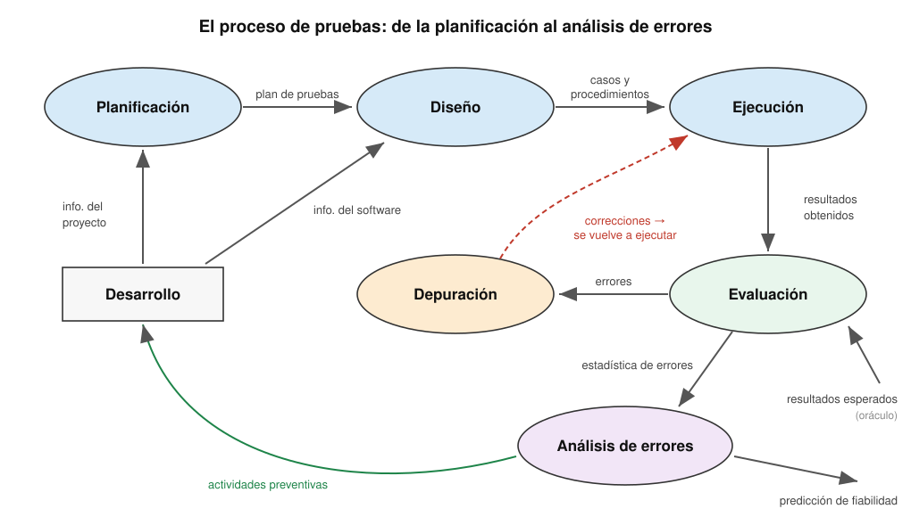
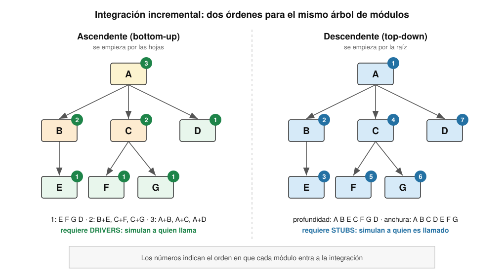
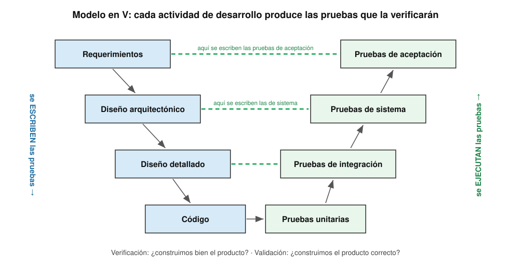
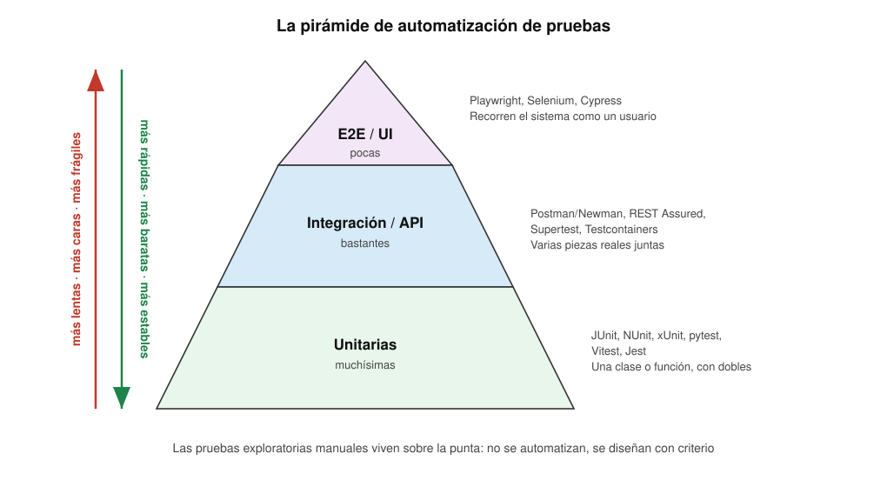
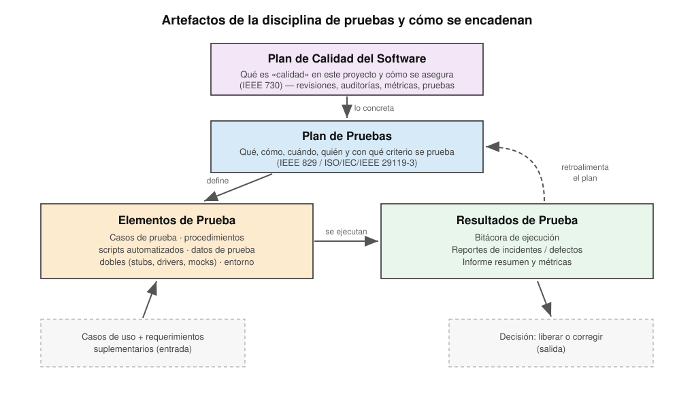

<!-- _class: cover -->
<style scoped>
section {
  --cover: url(../assets/img_00037_.png);
}
</style>
# Pruebas
## Contenidos
- Propósitos de la disciplina
- Pruebas de caja negra y caja blanca
- Tipos de pruebas
- Pruebas desde casos de uso y requerimientos suplementarios
- Estrategias: desarrollo, fase de pruebas y liberación
- Automatización y artefactos

> Curso **Análisis y Diseño de Sistemas** <br>II Semestre 2026

---

## ¿Dónde estamos?

- Ya sabemos **qué** debe hacer el sistema: requerimientos, casos de uso, especificaciones suplementarias
- Ya sabemos **cómo** se va a construir: arquitectura, clases de diseño, base de datos
- Falta la pregunta incómoda: **¿cómo sabemos que lo construido hace lo que se pidió?**

<div class="grid">
<div>

### 📋 Requerimientos
*¿Qué se pidió?*
Son la **vara** contra la que se mide
</div>
<div>

### 🏗️ Diseño e implementación
*¿Qué se construyó?*
Es el **objeto** que se mide
</div>
<div>

### 🧪 Pruebas
*¿Coinciden?*
Es el **acto** de medir, con evidencia
</div>
</div>

- ⚠️ Probar no es lo que se hace «al final, si sobra tiempo». Es una disciplina que **corre en paralelo** a todas las demás desde el primer día

---

<!-- _class: cover -->
<style scoped>
section {
  --cover: url(../assets/img_00051_.png);
}
</style>
# Propósitos de la disciplina
## Contenidos
- Qué es probar y qué no es
- Error, defecto y falla
- Los límites de las pruebas
- El oráculo
- Los siete principios
- El proceso de pruebas

---

## ¿Qué son las pruebas?

<steps>
<step>

### La definición

> «Las pruebas de software consisten en la **verificación dinámica** de que un programa ofrece los comportamientos esperados sobre un **conjunto finito de casos de prueba**, seleccionados adecuadamente del dominio de ejecución, normalmente infinito»
> — *SWEBOK v3, capítulo 4*

- **Dinámica**: siempre implica **ejecutar** el programa. Revisar código sin ejecutarlo es *verificación estática* (inspecciones, revisiones, análisis estático)
- **Finito**: nunca se prueba todo; se **escoge** qué probar
- **Esperados**: alguien tiene que saber de antemano qué debería pasar

</step>
<step>

### Para qué sirven

<div class="grid">
<div>

### 📏 Evaluar
Medir la **calidad** del producto con evidencia, no con opiniones
</div>
<div>

### 🔎 Encontrar
Identificar **defectos** antes de que los encuentre el usuario
</div>
<div>

### 🛡️ Prevenir
Diseñar pruebas temprano **expone ambigüedades** en los requerimientos
</div>
<div>

### ✅ Dar confianza
Aportar información para decidir **si se libera o no**
</div>
</div>

</step>
</steps>

---

## Los propósitos de la disciplina

| Propósito | Qué significa en la práctica |
|:--|:--|
| **Encontrar y documentar defectos** | En la calidad del software, no solo en el código: también en requerimientos y diseño |
| **Asesorar sobre la calidad percibida** | Darle a quien decide una lectura honesta del estado del producto |
| **Validar los supuestos** | Probar que las decisiones de diseño y de requerimientos **funcionan de verdad** |
| **Verificar que el producto funciona como se diseñó** | Comprobar el «cómo» contra la especificación |
| **Validar que se implementaron los requerimientos** | Comprobar el «qué» contra lo que el usuario pidió |
| **Reducir el riesgo** | Atacar primero lo que más daño haría si falla |

- 💡 Los propósitos vienen de la disciplina de pruebas del **RUP**. Ojo con el que **no** está: *«demostrar que el sistema no tiene errores»*

---

## Verificación y validación

<split-slide style="--left: 50%; --right: 50%;">
<div>

### ✔️ Verificación
*¿Estamos construyendo **bien** el producto?*

- Compara el producto contra su **especificación**
- Pregunta interna del equipo
- Se apoya en revisiones, inspecciones y pruebas de unidad e integración
- Un sistema puede pasar toda la verificación y aun así **no servirle a nadie**
</div>
<div>

### 🎯 Validación
*¿Estamos construyendo **el producto correcto**?*

- Compara el producto contra las **necesidades reales** del usuario
- Pregunta que solo contesta el usuario
- Se apoya en prototipos, pruebas de sistema y de aceptación
- Detecta los requerimientos **mal entendidos o ausentes**
</div>
</split-slide>

> «Verificación: ¿construimos bien el producto? Validación: ¿construimos el producto correcto?»
> — *Barry Boehm, 1979*

---

## Error, defecto y falla

| Término | Qué es | Dónde vive | Ejemplo |
|:--|:--|:--|:--|
| **Error** (equivocación) | Una acción **humana** que produce un resultado incorrecto | En la cabeza de alguien | El analista entendió «mayor que» donde el usuario dijo «mayor o igual» |
| **Defecto** (*bug*, falta) | La imperfección **en un artefacto**: código, requerimiento, diseño | En el producto | `if (edad > 18)` en vez de `if (edad >= 18)` |
| **Falla** (*failure*) | La desviación **observable** del comportamiento esperado al ejecutar | En la ejecución | Un estudiante de 18 años no puede matricular |
| **Incidente** | Cualquier evento que **requiere investigación** | En el reporte | «No me deja matricular» — ¿defecto, dato o mal uso? |

- 🔗 La cadena es siempre la misma: **error → defecto → falla**. Un defecto puede quedar dormido años si nadie ejecuta esa línea con ese dato
- 🎯 Las pruebas **provocan fallas**; la **depuración** encuentra el defecto que las causa. Son actividades distintas

---

## Ideas preconcebidas sobre las pruebas

<steps>
<step>

### Tres preguntas antes de empezar

- ❓ *¿Pueden las pruebas demostrar la **ausencia** de errores?* → <spoiler>No. Solo demuestran su presencia</spoiler>
- ❓ *¿Se puede hacer una prueba **exhaustiva**, con todas las posibilidades?* → <spoiler>No, salvo en programas de juguete. El espacio de entradas es astronómico</spoiler>
- ❓ *Si una prueba **descubre** un error, ¿tuvo éxito o fracasó?* → <spoiler>Tuvo éxito: para eso se escribió</spoiler>

</step>
<step>

### Por qué no se puede probar todo

- Una función que recibe **dos enteros de 32 bits** tiene 2⁶⁴ ≈ 1,8 × 10¹⁹ combinaciones. A un millón de pruebas por segundo: **más de 580 000 años**
- Y eso sin contar el **estado**: un sistema complejo reacciona distinto a la misma entrada según lo que pasó antes
- Hay que buscar un **equilibrio** entre recursos, tiempo y riesgo:
  - seleccionar **valores de entrada** representativos
  - seleccionar un **conjunto finito** de casos de prueba
  - el **criterio de selección** depende de la técnica de prueba

> «Probar programas sirve para demostrar la presencia de errores, pero nunca para demostrar su ausencia»
> — *Edsger W. Dijkstra, 1970*

</step>
</steps>

---

## El oráculo

<split-slide style="--left: 50%; --right: 50%;">
<div>

### Qué es
> Agente — humano o no — que decide si un programa actuó correctamente en una prueba dada, emitiendo un veredicto de **«pasa»** o **«falla»**

- Toda prueba compara la **salida obtenida** con la **esperada**
- La salida esperada sale de: la especificación, los requerimientos, las expectativas del usuario, un sistema anterior, un cálculo independiente
- ⚠️ Sin oráculo no hay prueba: hay **ejecución**
</div>
<div>

### Tipos de oráculo

| Oráculo | Ejemplo |
|:--|:--|
| **Especificación** | «El IVA es el 13 % del subtotal» |
| **Sistema de referencia** | El sistema viejo calculaba lo mismo |
| **Cálculo inverso** | `raiz(x)² ≈ x` |
| **Propiedad** | Una lista ordenada no cambia de tamaño |
| **Humano experto** | La contadora revisa el reporte |
| **Regresión** | Hoy da lo mismo que ayer |

</div>
</split-slide>

---

## Ejemplo: ¿bastan estos casos?

<split-slide style="--left: 48%; --right: 52%;">
<div>

### El código

```text
if (A + B + C) / 3 == A
then print("A, B y C son iguales")
else print("A, B y C no son iguales")
```

### Los casos propuestos

| Caso | A | B | C | Salida | ¿Correcto? |
|:--|:--|:--|:--|:--|:--|
| 1 | 5 | 5 | 5 | iguales | ✅ |
| 2 | 2 | 3 | 7 | no iguales | ✅ |

</div>
<div>

### Las preguntas

- ❓ *¿Son suficientes estos dos casos?* → <spoiler>No: ambos pasan y el programa está mal</spoiler>
- ❓ *¿Qué caso lo rompe?* → <spoiler>A = 2, B = 1, C = 3: el promedio es 2 = A, pero no son iguales</spoiler>
- ❓ *¿Qué cobertura de sentencias logran los dos casos?* → <spoiler>100 %. Y aun así el defecto sobrevive</spoiler>

- 🔑 Lección: **cubrir todo el código no es probar todo el comportamiento**. Hace falta pensar en las entradas que **engañan** a la lógica
</div>
</split-slide>

---

## Los siete principios de las pruebas

<div class="grid">
<div>

### 1️⃣ Muestran presencia
Las pruebas revelan defectos; **no** prueban que no existan
</div>
<div>

### 2️⃣ Exhaustivas: imposibles
Se prueba por **riesgo y prioridad**, no todo
</div>
<div>

### 3️⃣ Temprano ahorra
Un defecto en requerimientos cuesta **mucho menos** si se encuentra ahí (*shift-left*)
</div>
<div>

### 4️⃣ Los defectos se agrupan
Pocos módulos concentran la mayoría de los defectos (Pareto)
</div>
<div>

### 5️⃣ La paradoja del pesticida
Repetir siempre las mismas pruebas deja de encontrar defectos nuevos
</div>
<div>

### 6️⃣ Dependen del contexto
No se prueba igual un videojuego que un marcapasos
</div>
<div>

### 7️⃣ Falacia de la ausencia de errores
Un sistema sin defectos que **no resuelve la necesidad** sigue siendo un fracaso
</div>
</div>

- 📎 Fuente: *ISTQB Certified Tester Foundation Level*, v4.0 (2023)

---

## El proceso de pruebas

[](../assets/ads-pru-proceso.svg)

---

## Las actividades del proceso

| Actividad | Qué se hace | Qué produce |
|:--|:--|:--|
| **Planificación** | Definir alcance, enfoque, recursos, calendario, riesgos y criterios de salida | **Plan de pruebas** |
| **Diseño** | Escoger técnicas, derivar casos, preparar datos y entorno | **Casos y procedimientos** |
| **Ejecución** | Correr los casos — a mano o automatizados — y registrar lo que pasó | **Bitácora** de ejecución |
| **Evaluación** | Comparar lo obtenido con lo esperado (oráculo) | Veredictos y **reportes de incidentes** |
| **Depuración** | Localizar y corregir el defecto que causó la falla | Software corregido → **se vuelve a probar** |
| **Análisis de errores** | Estadísticas: dónde se concentran, por qué ocurren | **Informe resumen**, acciones preventivas |

- 🔁 La flecha que vuelve a **Desarrollo** es la más valiosa: si un tipo de defecto se repite, se cambia el **proceso**, no solo el código

---

<!-- _class: cover -->
<style scoped>
section {
  --cover: url(../assets/img_00052_.png);
}
</style>
# Caja negra y caja blanca
## Contenidos
- Los dos enfoques
- Partición de equivalencia y valores límite
- Tablas de decisión y transición de estados
- Criterios de cobertura
- Complejidad ciclomática y caminos básicos
- Otras fuentes de casos de prueba

---

## Dos formas de mirar el programa

<split-slide style="--left: 50%; --right: 50%;">
<div>

### ⬛ Caja negra — *funcional*
- Los casos se basan **solo** en el comportamiento de **entrada / salida**
- Se diseñan desde la **especificación**: requerimientos, casos de uso, contratos
- No hace falta ver el código: lo puede diseñar alguien que **nunca lo leyó**
- Buscan asegurar que:
  - se probó **toda clase** de entrada
  - la salida observada **es** la esperada
- Encuentran: funciones **faltantes**, interpretaciones erróneas, errores de interfaz
</div>
<div>

### ⬜ Caja blanca — *estructural*
- Los casos se basan en **cómo** se diseñó o codificó el software
- Se diseñan desde el **código**: decisiones, caminos, flujo de datos
- Interesa la **cobertura** alcanzada dentro de la unidad bajo prueba
- Buscan asegurar que:
  - cada **sentencia** y cada **decisión** se ejercitó
  - no quedan caminos **sin recorrer**
- Encuentran: código **muerto**, ramas olvidadas, condiciones mal escritas
</div>
</split-slide>

- 🔑 No compiten, **se complementan**: la caja blanca no ve lo que **falta** en el código; la caja negra no ve lo que **sobra**
- 💡 **Caja gris**: se diseña desde la especificación, pero conociendo la arquitectura interna (típico en pruebas de integración y de API)

---

## Caja negra: partición de equivalencia

<steps>
<step>

### La idea

- Dividir el dominio de entrada en **clases de equivalencia**: conjuntos de valores que el programa **debería tratar igual**
- Si un valor de la clase revela un defecto, los demás probablemente también. Basta **un representante** por clase
- Se identifican clases **válidas** y **no válidas**

</step>
<step>

### Ejemplo: *«El sistema acepta matrícula a estudiantes de 16 a 65 años, con un máximo de 18 créditos»*

| Entrada | Clases válidas | Clases no válidas |
|:--|:--|:--|
| Edad | **CE1**: 16 ≤ edad ≤ 65 | **CE2**: edad < 16 · **CE3**: edad > 65 · **CE4**: no numérica |
| Créditos | **CE5**: 1 ≤ créditos ≤ 18 | **CE6**: créditos < 1 · **CE7**: créditos > 18 |

- Regla: un caso de prueba cubre **todas las clases válidas que pueda**, pero **una sola clase no válida** a la vez — si no, un error tapa al otro

| Caso | Edad | Créditos | Clases cubiertas | Esperado |
|:--|:--|:--|:--|:--|
| 1 | 30 | 12 | CE1, CE5 | Acepta |
| 2 | 10 | 12 | CE2 | Rechaza por edad |
| 3 | 30 | 25 | CE7 | Rechaza por créditos |

</step>
</steps>

---

## Caja negra: valores límite

<split-slide style="--left: 50%; --right: 50%;">
<div>

### Por qué los bordes
- Los programadores se equivocan **en los bordes**: `<` en vez de `<=`, contar desde 0 o desde 1
- Complementa la partición: en vez de **cualquier** valor de la clase, se escogen los de **la frontera**
- Para un rango `[min, max]` se prueban: `min-1`, `min`, `max`, `max+1` (y a veces `min+1`, `max-1`)
</div>
<div>

### Para el ejemplo anterior

| Entrada | Valores límite |
|:--|:--|
| Edad | **15**, **16**, **65**, **66** |
| Créditos | **0**, **1**, **18**, **19** |

- También en las **salidas**: un reporte con 0 filas, con 1, con el máximo de una página, con una más
- Y en las **estructuras**: lista vacía, un elemento, llena
</div>
</split-slide>

- ❓ *Si el código dice `if (edad > 16 && edad < 65)`, ¿qué casos lo atrapan?* → <spoiler>edad = 16 y edad = 65: deberían aceptarse y se rechazan</spoiler>

---

## Caja negra: tablas de decisión y estados

<split-slide style="--left: 52%; --right: 48%;">
<div>

### 📊 Tabla de decisión
Cuando la salida depende de **combinaciones** de condiciones

| Condición | R1 | R2 | R3 | R4 |
|:--|:--|:--|:--|:--|
| ¿Usuario activo? | S | S | S | N |
| ¿Tiene multas? | N | N | S | — |
| ¿Ejemplar disponible? | S | N | — | — |
| **Acción** | Presta | Reserva | Rechaza: multa | Rechaza: inactivo |

- Cada **columna** es un caso de prueba
- `—` significa «no importa»: reduce combinaciones
</div>
<div>

### 🔄 Transición de estados
Cuando el comportamiento depende de la **historia**

- Se parte del **diagrama de estados** del objeto
- Criterios de cobertura:
  - visitar **cada estado**
  - disparar **cada transición**
  - intentar las transiciones **inválidas**
- Ejemplo con `Prestamo`: `Activo → Devuelto` ✅ · `Devuelto → Activo` ❌ debe rechazarse
- 📎 La notación está en el mazo de **UML**
</div>
</split-slide>

---

## Caja blanca: criterios de cobertura

| Criterio | Exige que… | Fuerza |
|:--|:--|:--|
| **Sentencias** | Cada sentencia se ejecute **al menos una vez** | La más débil |
| **Decisiones** (ramas) | Cada decisión tome **al menos una vez verdadero y una vez falso** | Incluye a sentencias |
| **Condiciones** | Cada condición **atómica** de cada decisión tome verdadero y falso | No siempre incluye a decisiones |
| **Decisión / condición** | Se cumplan **a la vez** los criterios de condiciones y de decisiones | Incluye a ambos |
| **Condición múltiple** | Se prueben **todas las combinaciones** de condiciones de cada decisión | La más fuerte — y la más cara |

```java
if (edad >= 16 && creditos <= 18) { aceptar(); } else { rechazar(); }
```

- **Decisiones**: basta `(20, 10)` → V y `(10, 10)` → F
- **Condiciones**: `(20, 25)` y `(10, 10)` — cada condición fue V y F, ¡pero la decisión **nunca** fue verdadera!
- **Condición múltiple**: las 4 combinaciones `VV`, `VF`, `FV`, `FF`

---

## Caja blanca: cobertura en la práctica

<split-slide style="--left: 55%; --right: 45%;">
<div>

### Un método real

```java
public int getTipo() {
  if (i <= 0 || j <= 0 || k <= 0)
    return NO_TRIANGULO;
  if (i + j <= k || j + k <= i || i + k <= j)
    return NO_TRIANGULO;
  if (i == j && j == k)
    return EQUILATERO;
  if (i == j || j == k || i == k)
    return ISOSCELES;
  return ESCALENO;
}
```

</div>
<div>

### Valores interesantes
> Un valor **interesante** es aquel que permite recorrer la mayor cantidad de código posible

- ❓ *¿Qué conjunto mínimo de `(i, j, k)` logra 100 % de sentencias?* → <spoiler>(0,2,4) · (2,3,5) · (2,2,2) · (2,2,3) · (3,4,5)</spoiler>
- Se ayuda uno con **partición** y **límites**: `(2,3,5)` está justo en el borde de la desigualdad triangular
- Las herramientas (JaCoCo, Istanbul, coverage.py) **miden** la cobertura y señalan las líneas sin recorrer
</div>
</split-slide>

- ⚠️ Ley de Goodhart aplicada: cuando el 80 % de cobertura se vuelve **meta**, aparecen pruebas que ejecutan código **sin verificar nada**

---

## Caja blanca: complejidad ciclomática

<steps>
<step>

### La métrica de McCabe

- Se dibuja el **grafo de flujo** del método: nodos = bloques de sentencias, aristas = saltos
- La **complejidad ciclomática** `V(G)` es el número de **caminos linealmente independientes**:

| Fórmula | Significado |
|:--|:--|
| `V(G) = E − N + 2` | Aristas menos nodos más 2 |
| `V(G) = P + 1` | Decisiones simples (predicados) más 1 |
| `V(G) = regiones` | Regiones cerradas del grafo más la exterior |

</step>
<step>

### Para qué sirve

<div class="grid">
<div>

### 🧪 Mínimo de casos
`V(G)` es el número **mínimo** de casos para cubrir todos los caminos básicos: garantiza sentencias y decisiones
</div>
<div>

### 📏 Señal de alerta
`V(G) > 10` suele indicar un método difícil de probar y de mantener: candidato a **refactorizar**
</div>
<div>

### 🧭 Guía del diseño
Si un método necesita 25 casos para cubrirse, el problema no son las pruebas: es el **diseño**
</div>
</div>

- ❓ *¿Cuánto vale `V(G)` para `getTipo()` si cada `||` y `&&` cuenta como un predicado?* → <spoiler>1 + 3 + 3 + 2 + 3 = 12. Merece dividirse</spoiler>

</step>
</steps>

---

## Otras fuentes de casos de prueba

| Fuente | Técnicas |
|:--|:--|
| **La experiencia del ingeniero** | Ad hoc, **exploratorias**, adivinación de errores (*error guessing*) |
| **La especificación** | Partición de equivalencia, valores límite, tablas de decisión, máquinas de estados, **casos de uso**, aleatorias |
| **La estructura del código** | Flujo de control (cobertura), **flujo de datos** (definición–uso de variables) |
| **Los defectos** | Modelos de fallas típicas, **mutación** (se inyectan defectos para medir si las pruebas los detectan) |
| **El campo de uso** | **Perfil operacional**: se prueba más lo que más se usa; pruebas guiadas por objetivos de fiabilidad (SRET) |
| **La naturaleza de la aplicación** | Orientada a objetos, basada en componentes, web, interfaz de usuario, concurrente, tiempo real, crítica |

- 📎 Clasificación tomada del **SWEBOK v3, capítulo 4**: el criterio es **de dónde salen** los casos, no qué tan «negros» o «blancos» son

---

<!-- _class: cover -->
<style scoped>
section {
  --cover: url(../assets/img_00023_.png);
}
</style>
# Tipos de pruebas
## Contenidos
- Niveles: unidad, integración, sistema, aceptación
- Componentes y casos de uso
- Alfa, beta e instalación
- Seguridad y otras no funcionales
- Regresión y humo
- Pruebas en sistemas orientados a objetos

---

## Dos ejes para clasificar

<split-slide style="--left: 50%; --right: 50%;">
<div>

### 📐 Por nivel (*¿qué tamaño?*)

| Nivel | Objeto bajo prueba |
|:--|:--|
| **Unidad** | Un módulo, una clase, un método |
| **Componentes** | Una pieza reemplazable con interfaz |
| **Integración** | Un grupo de módulos que colaboran |
| **Sistema** | El sistema completo |
| **Aceptación** | El sistema, frente al cliente |

</div>
<div>

### 🎯 Por objetivo (*¿qué se busca?*)

| Tipo | Qué comprueba |
|:--|:--|
| **Funcionales** | Que hace lo que debe |
| **No funcionales** | Seguridad, rendimiento, usabilidad… |
| **De confirmación** | Que el defecto corregido ya no está |
| **De regresión** | Que lo que funcionaba sigue funcionando |
| **De instalación** | Que se instala en el entorno real |

</div>
</split-slide>

- 🔑 Los ejes **se cruzan**: una prueba de rendimiento puede ser de componente o de sistema; una de regresión puede ser de cualquier nivel

---

## Pruebas de unidad

<split-slide style="--left: 52%; --right: 48%;">
<div>

### Qué verifican
- El funcionamiento **aislado** de piezas de software que pueden probarse por separado
  - subprogramas o módulos individuales
  - en OO, **la clase** y sus métodos
- Se aíslan las dependencias con **dobles de prueba**: *stubs*, *mocks*, *fakes*

### Cómo se hacen
- Con **acceso al código fuente**
- Con ayuda de herramientas de depuración y frameworks *xUnit*
- Normalmente las escribe **quien escribió el código**
</div>
<div>

### Un caso de prueba de unidad en OO
1. **Construir** una instancia de la clase bajo prueba
2. **Ejecutar** una serie de servicios sobre ella
3. **Comprobar** el resultado contra el oráculo

### Lo que buscan
- Errores de **cálculo** y de lógica
- Condiciones **límite** mal manejadas
- Caminos de **error** que nunca se ejecutaron
- Estructuras de datos **inconsistentes**
</div>
</split-slide>

- 💡 Deben ser **F.I.R.S.T.**: *Fast, Independent, Repeatable, Self-validating, Timely*

---

## Pruebas de integración

<steps>
<step>

### Qué verifican

- La **interacción** entre componentes del sistema: que las interfaces encajen, que los datos crucen sin perderse, que los errores se propaguen bien
- Defectos típicos: parámetros en **orden distinto**, unidades distintas (colones vs. dólares), suposiciones distintas sobre nulos, *timeouts*

| Estrategia | Idea | Riesgo |
|:--|:--|:--|
| **Big bang** | Se junta todo de una vez | Cuando falla, no se sabe dónde |
| **Incremental ascendente** | Desde las hojas hacia la raíz | La lógica de control se prueba al final |
| **Incremental descendente** | Desde la raíz hacia las hojas | Muchos *stubs*; el procesamiento real llega tarde |
| **Sándwich** | Ambas a la vez, se encuentran en el medio | Más coordinación |
| **Guiada por la arquitectura** | Se integra por **hilos de funcionalidad** | Hay que conocer bien los hilos |

</step>
<step>

[](../assets/ads-pru-integracion.svg)

</step>
</steps>

---

## Stubs y drivers

<split-slide style="--left: 50%; --right: 50%;">
<div>

### 🔽 Stub (resguardo)
- Reemplaza a un módulo **llamado** que todavía no existe o no se quiere usar
- Devuelve respuestas **predefinidas**
- Lo necesita la integración **descendente**
- Ejemplo: `CobrosStub.consultarDeuda()` siempre devuelve `0`
</div>
<div>

### 🔼 Driver (controlador)
- Reemplaza al módulo **que llama**
- Prepara los datos, invoca al módulo bajo prueba y revisa el resultado
- Lo necesita la integración **ascendente**
- Hoy casi siempre es el propio **framework de pruebas**: JUnit es un *driver*
</div>
</split-slide>

| Doble de prueba | Qué hace |
|:--|:--|
| **Dummy** | Se pasa pero nunca se usa; solo llena un parámetro |
| **Stub** | Devuelve respuestas fijas |
| **Spy** | Un stub que además **registra** cómo lo llamaron |
| **Mock** | Viene programado con **expectativas** y falla si no se cumplen |
| **Fake** | Implementación real pero simplificada: base de datos en memoria |

---

## Pruebas de componentes

- Prueban un **componente** — pieza modular y reemplazable con **interfaces bien definidas** — a través de esas interfaces, sin mirar adentro
- Están entre la unidad y la integración: el componente puede tener **muchas clases** adentro, pero se prueba como una sola cosa

<div class="grid">
<div>

### 🔌 Contra la interfaz provista
Cada operación de `IGestionMatricula` se prueba con sus precondiciones, poscondiciones y excepciones
</div>
<div>

### 🧩 Con la interfaz requerida simulada
`IAutenticacion` y `ICobros` se sustituyen por dobles para aislar el componente
</div>
<div>

### 📜 Pruebas de contrato
El consumidor publica qué espera; el proveedor verifica que lo cumple (Pact, Spring Cloud Contract)
</div>
</div>

- 🎯 El beneficio: el componente se puede **reemplazar** por otra implementación y las mismas pruebas siguen valiendo
- 📎 La definición de componente e interfaz provista/requerida está en el mazo de **Diseño de sistemas**

---

## Pruebas de sistema

<split-slide style="--left: 50%; --right: 50%;">
<div>

### Qué verifican
- El comportamiento del sistema **en su conjunto**, en un entorno lo más parecido posible al de producción
- Los fallos funcionales se suelen detectar en los niveles anteriores
- Este nivel es **el más adecuado** para comprobar los requerimientos **no funcionales**:
  - seguridad, velocidad, exactitud, fiabilidad
</div>
<div>

### También se prueban
- **Interfaces externas** con otros sistemas
- **Utilidades**: respaldos, recuperación, carga de datos
- **Unidades físicas**: impresoras, lectores, sensores
- **Entorno operativo**: sistema operativo, navegadores, red
- La **documentación** de usuario contra el sistema real
</div>
</split-slide>

- ⚠️ Las prueba un **equipo independiente** del que construyó: quien lo programó tiende a usarlo de la forma en que sabe que funciona

---

## Pruebas de casos de uso

- Son pruebas **funcionales de caja negra** a nivel de sistema, en las que **cada caso de uso** es la fuente de los casos de prueba
- Cada **escenario** — un camino concreto por el flujo básico y los alternos — se vuelve **al menos un** caso de prueba

| Lo que tiene el caso de uso | Lo que aporta a la prueba |
|:--|:--|
| **Precondiciones** | El estado inicial que hay que preparar |
| **Flujo básico** | El escenario principal: el primer caso de prueba |
| **Flujos alternos y de excepción** | Un escenario cada uno: los casos negativos |
| **Poscondiciones** | El oráculo: qué debe quedar cierto al terminar |
| **Reglas de negocio** | Los valores para partición y límites |
| **Requerimientos especiales** | Las pruebas no funcionales asociadas |

- 🔑 Ventaja: la **trazabilidad es directa**. Si el caso de uso cambia, se sabe exactamente qué pruebas revisar
- 📎 La técnica completa está en la sección **Creación de las pruebas** más adelante

---

## Pruebas de aceptación

<split-slide style="--left: 50%; --right: 50%;">
<div>

### Qué son
- Comprueban el comportamiento del sistema **frente a los requerimientos del cliente**
- Las ejecuta — o al menos las aprueba — **el cliente o los usuarios**
- Responden una sola pregunta: **¿lo recibimos o no?**
- Suelen ser una condición **contractual** para cerrar una etapa o pagar
</div>
<div>

### Sus variantes

| Tipo | Quién la hace |
|:--|:--|
| **De usuario (UAT)** | Usuarios finales, sobre sus tareas reales |
| **Operacional** | Operaciones: respaldos, recuperación, monitoreo |
| **Contractual** | Contra los criterios del contrato |
| **Regulatoria** | Contra una norma o ley |
| **Alfa y beta** | Usuarios potenciales, antes de la difusión |

</div>
</split-slide>

- 💡 En ágil: los **criterios de aceptación** de cada historia se escriben como escenarios ejecutables — *Dado… Cuando… Entonces…* (BDD, Gherkin)

---

## Pruebas alfa y beta

<split-slide style="--left: 50%; --right: 50%;">
<div>

### 🅰️ Alfa
- En las **instalaciones del desarrollador**
- Usuarios reales o representativos, **observados** por el equipo
- Entorno **controlado**: se registran errores y problemas de uso en el momento
- El producto está casi completo, pero todavía puede cambiar
</div>
<div>

### 🅱️ Beta
- **Fuera** de la organización, en el entorno **real** del usuario
- El desarrollador **no** está presente
- Los usuarios reportan problemas por un canal acordado
- Se descubren combinaciones de hardware, datos y usos que nadie previó
</div>
</split-slide>

- Son pruebas en **grupos pequeños** de usuarios potenciales **antes** de la difusión del software
- Variantes actuales: **acceso anticipado**, **lanzamiento canario** (un 5 % de los usuarios recibe la versión nueva), *feature flags*
- ❓ *Una app bancaria invita a 200 clientes a usar la versión nueva desde su celular por dos semanas* → <spoiler>beta</spoiler>

---

## Pruebas de instalación

- Comprueban el comportamiento del sistema frente a los **requerimientos de configuración**: hardware, sistema operativo, red, otros productos
- Se ejecutan en el **entorno destino** o en uno equivalente

<div class="grid">
<div>

### 📦 Instalación limpia
En una máquina sin versiones previas
</div>
<div>

### ⬆️ Actualización
Desde la versión anterior, **conservando los datos**
</div>
<div>

### ↩️ Reversión
Volver a la versión anterior si la nueva falla
</div>
<div>

### 🗑️ Desinstalación
Sin dejar basura ni romper otros productos
</div>
<div>

### ⚙️ Configuraciones
Cada combinación soportada de SO, navegador, base de datos
</div>
<div>

### 📄 Documentación
Seguir el manual de instalación **al pie de la letra**
</div>
</div>

- 💡 En sistemas web modernos, la instalación es el **despliegue**: se prueba con *scripts* de infraestructura como código y pruebas de humo posteriores

---

## Pruebas de seguridad

<steps>
<step>

### Qué comprueban

- Que el sistema **protege la información** y mantiene su funcionalidad frente a usos maliciosos
- Se derivan de los **requerimientos de seguridad** de la especificación suplementaria y de un **modelo de amenazas**

| Propiedad | Pregunta que se prueba |
|:--|:--|
| **Confidencialidad** | ¿Un estudiante puede ver las notas de otro? |
| **Integridad** | ¿Se puede alterar un monto en tránsito? |
| **Disponibilidad** | ¿Aguanta un pico de peticiones malintencionadas? |
| **Autenticación** | ¿Se puede entrar sin credenciales válidas? |
| **Autorización** | ¿Un docente puede ejecutar funciones de administrador? |
| **No repudio** | ¿Queda **bitácora** de quién hizo qué? |

</step>
<step>

### Cómo se hacen

<div class="grid">
<div>

### 🔍 SAST
Análisis **estático** del código buscando patrones vulnerables (SonarQube, Semgrep)
</div>
<div>

### 🌐 DAST
Análisis **dinámico** del sistema en ejecución (OWASP ZAP, Burp Suite)
</div>
<div>

### 📦 Dependencias
Bibliotecas con vulnerabilidades conocidas (Dependabot, OWASP Dependency-Check)
</div>
<div>

### 🥷 Pruebas de penetración
Un especialista **autorizado** intenta atacar el sistema como lo haría un atacante real
</div>
</div>

- 📎 Lista de referencia: **OWASP Top 10** y la guía de pruebas **OWASP WSTG**

</step>
</steps>

---

## Otras pruebas no funcionales

| Tipo | Qué comprueba | Ejemplo |
|:--|:--|:--|
| **Rendimiento** | Tiempos de respuesta con carga **normal** | «El préstamo se registra en menos de 2 s» |
| **Carga** | Comportamiento con la carga **esperada máxima** | 4 000 usuarios en la matrícula |
| **Estrés** | Dónde y cómo **se rompe** más allá del máximo | ¿Se degrada con dignidad o se cae? |
| **Volumen** | Grandes cantidades de **datos** | Un reporte de 10 años de historia |
| **Usabilidad** | Facilidad de aprendizaje y de uso | 5 usuarios nuevos completan la tarea sin ayuda |
| **Accesibilidad** | Uso por personas con discapacidad | Navegable solo con teclado; WCAG 2.2 AA |
| **Recuperación** | Vuelta a la operación tras una falla | Se corta la base de datos en medio de una transacción |
| **Compatibilidad** | Funcionamiento en distintos entornos | Chrome, Firefox, Safari; Android e iOS |

- 💡 Todas salen de la **especificación suplementaria**. Si un requerimiento no funcional no tiene una prueba asociada, es un **deseo**, no un requerimiento

---

## Regresión, confirmación y humo

<div class="grid">
<div>

### 🔁 Regresión
Volver a ejecutar pruebas que **ya pasaban** después de un cambio, para detectar efectos colaterales. Es la razón número uno para **automatizar**
</div>
<div>

### ✅ Confirmación (*re-test*)
Volver a ejecutar **el caso que falló** después de corregir el defecto, para confirmar la corrección
</div>
<div>

### 💨 Humo (*smoke*)
Un subconjunto **pequeño y rápido** que verifica que lo esencial funciona: ¿arranca? ¿se puede entrar? Si falla, no vale la pena seguir probando
</div>
<div>

### 🧪 Cordura (*sanity*)
Una revisión rápida y **enfocada** en la funcionalidad recién cambiada
</div>
</div>

- ⚠️ Cada corrección es un **cambio**, y cada cambio puede romper otra cosa. Sin regresión, se arregla un defecto y se introducen dos

---

## Resumen: clasificación según finalidad

| Comprueban… | Tipo de prueba | Quién participa |
|:--|:--|:--|
| Que las especificaciones funcionales están **implementadas correctamente** | Unidad, componentes e integración | Desarrolladores |
| El comportamiento funcional **de punta a punta** | Sistema, casos de uso | Equipo de pruebas |
| Los requerimientos **no funcionales** | Sistema: seguridad, rendimiento, usabilidad… | Equipo de pruebas, especialistas |
| El comportamiento frente a los **requerimientos del cliente** | Aceptación | El cliente o los usuarios |
| El comportamiento frente a la **configuración** de hardware y software | Instalación | Operaciones, equipo de pruebas |
| El sistema con **usuarios potenciales** antes de la difusión | Alfa (adentro) y beta (afuera) | Usuarios reales |
| Que nada **se rompió** tras un cambio | Regresión | Automatización |

---

## Pruebas en sistemas orientados a objetos

<steps>
<step>

### Qué cambia

- Las pruebas de sistemas **estructurados** y de sistemas **OO** difieren por las características de cada paradigma
- No todas las pruebas se hacen sobre código: también sobre los **modelos** (revisar que el diagrama de clases soporte todos los escenarios)

| Concepto estructurado | Equivalente en OO | Lo que complica |
|:--|:--|:--|
| Módulo | **La clase** | Un método no se puede probar sin el **estado** del objeto |
| Llamada a procedimiento | Mensaje entre objetos | El **polimorfismo**: no se sabe qué método se ejecuta hasta correr |
| Jerarquía de llamadas | Red de colaboraciones | No hay un árbol claro para integrar de arriba abajo |
| — | **Herencia** | Lo probado en la superclase **no queda probado** en la subclase |
| — | **Encapsulamiento** | El estado interno no se ve: hay que observarlo por la interfaz |

</step>
<step>

### Los tres niveles en OO

<div class="grid">
<div>

### 1️⃣ Unidad = clase
Se prueba cada **método** (caja negra y blanca) y luego las **secuencias** de métodos que cambian el estado del objeto
</div>
<div>

### 2️⃣ Integración
**Por hilos** (las clases de un diagrama de secuencia), **por uso** (de las más independientes a las más dependientes) o **por agrupamiento** (clases colaboradoras)
</div>
<div>

### 3️⃣ Validación
Desaparecen las clases: se prueba el **comportamiento visible** contra los casos de uso, igual que en cualquier sistema
</div>
</div>

- 💡 Para sistemas reales, importa **minimizar** el número de casos de prueba: la explosión de combinaciones entre estados y mensajes es real

</step>
</steps>

---

## Ejemplo de prueba de validación

<split-slide style="--left: 55%; --right: 45%;">
<div>

### Caso de prueba: *Pagar ₡150 000 por una bicicleta de montaña*

**Precondiciones (estado inicial)**
- Existe un pedido válido de la bicicleta, enviado a un vendedor
- El precio es **₡150 000**, envío incluido
- El comprador recibió la confirmación del pedido `ID 12345`
- Existe una factura de ₡150 000 en estado **pendiente**, que apunta a la cuenta `22-222-2222` del vendedor, con saldo **₡963 000**
- La cuenta `11-111-1111` del comprador tiene saldo **₡175 000**
</div>
<div>

**Resultado esperado**
- La factura pasa a estado **cerrada**
- Saldo de `11-111-1111` = **₡25 000**
- Saldo de `22-222-2222` = **₡1 113 000**

**Condiciones de ejecución**
- Ninguna otra instancia puede acceder a las cuentas durante el caso de prueba

- 🔑 Ninguna clase aparece en el caso: solo **estados observables** antes y después. Eso lo hace un caso de **validación**
</div>
</split-slide>

---

<!-- _class: cover -->
<style scoped>
section {
  --cover: url(../assets/img_00024_.png);
}
</style>
# Creación de las pruebas
## Contenidos
- Del caso de uso al caso de prueba en tres pasos
- Escenarios, matriz de casos y datos
- Pruebas desde los requerimientos suplementarios
- La matriz de trazabilidad

---

## Por qué partir de los casos de uso

- El caso de uso ya describe **qué hace el sistema** desde el punto de vista del actor: es casi un guion de prueba escrito de antemano
- Diseñar las pruebas **mientras** se escribe el caso de uso es la mejor revisión que puede tener: un flujo que no se puede probar es un flujo **mal especificado**

<div class="grid">
<div>

### 📄 Caso de uso
Describe **todos** los caminos posibles, en lenguaje del negocio
</div>
<div>

### 🛤️ Escenario
Es **una instancia** del caso de uso: un camino concreto de principio a fin
</div>
<div>

### 🧪 Caso de prueba
Es un escenario **con datos concretos**, condiciones y resultado esperado
</div>
</div>

> Un **caso de prueba** es un conjunto de entradas, condiciones de ejecución y resultados esperados, desarrollado para un objetivo particular: ejercitar un camino o verificar un requerimiento
> — *IEEE 610.12*

---

## El método en tres pasos

| Paso | Qué se hace | Qué se obtiene |
|:--|:--|:--|
| **1. Generar los escenarios** | Combinar el flujo básico con cada flujo alterno — y con las combinaciones que tengan sentido | Una lista de **escenarios** completos |
| **2. Identificar los casos de prueba** | Para cada escenario, determinar las **condiciones** que lo hacen ocurrir y el **resultado esperado** | Una **matriz** de casos con V / I / N/A |
| **3. Identificar los valores de datos** | Reemplazar cada V e I por un **dato concreto** que cumpla la condición | Casos **ejecutables** |

- 📎 Técnica de **Jim Heumann**, *Generating Test Cases From Use Cases* (Rational, 2001)
- 🔑 Se trabaja **por caso de uso** y en **prioridad**: primero los casos de uso de mayor riesgo o valor para el negocio

---

## Paso 1: generar los escenarios

<split-slide style="--left: 48%; --right: 52%;">
<div>

### El caso de uso: «Prestar un libro»

**Flujo básico**
1. El usuario presenta su carné
2. El sistema verifica que el usuario esté activo y sin multas
3. El bibliotecario digita el código del ejemplar
4. El sistema verifica que el ejemplar esté disponible
5. El sistema registra el préstamo con la fecha de devolución según el tipo de usuario
6. El sistema imprime el comprobante

**Flujos alternos**
- **FA1** Usuario inactivo → rechaza
- **FA2** Usuario con multas → rechaza y muestra el monto
- **FA3** Código de ejemplar inexistente → solicita de nuevo
- **FA4** Ejemplar prestado → ofrece reservarlo
</div>
<div>

### Los escenarios

| Esc. | Recorrido |
|:--|:--|
| **E1** | Flujo básico completo |
| **E2** | Básico + FA1 |
| **E3** | Básico + FA2 |
| **E4** | Básico + FA3, luego vuelve al básico |
| **E5** | Básico + FA4 |
| **E6** | Básico + FA3 + FA4 |

- Cada flujo alterno **regresa al básico o termina**: eso define cuántos escenarios hay
- No se combinan alternos que **no pueden** darse juntos (FA1 y FA2 son excluyentes en el paso 2)
</div>
</split-slide>

---

## Paso 2: la matriz de casos de prueba

| Caso | Esc. | Usuario activo | Sin multas | Código existe | Ejemplar disponible | Resultado esperado |
|:--|:--|:--|:--|:--|:--|:--|
| **CP1** | E1 | V | V | V | V | Préstamo registrado, comprobante impreso con fecha correcta |
| **CP2** | E2 | **I** | N/A | N/A | N/A | Rechazo: «usuario inactivo» |
| **CP3** | E3 | V | **I** | N/A | N/A | Rechazo con el monto de la multa |
| **CP4** | E4 | V | V | **I** → V | V | Solicita el código de nuevo; luego, préstamo registrado |
| **CP5** | E5 | V | V | V | **I** | Ofrece reservar; no se registra préstamo |
| **CP6** | E6 | V | V | **I** → V | **I** | Solicita el código; luego ofrece reservar |

- **V** = válido · **I** = inválido · **N/A** = no aplica (el flujo terminó antes)
- 🎯 Cada fila debe tener **al menos una condición** que la distinga de las demás. Dos filas idénticas son un caso repetido

---

## Paso 3: los valores de datos

| Caso | Carné | Estado del usuario | Multas | Código | Estado del ejemplar | Esperado |
|:--|:--|:--|:--|:--|:--|:--|
| **CP1** | `B12345` (estudiante) | activo | ₡0 | `EJ-0042` | disponible | Devolución = hoy + **7 días** |
| **CP1b** | `D00871` (docente) | activo | ₡0 | `EJ-0042` | disponible | Devolución = hoy + **30 días** |
| **CP2** | `B99999` | **inactivo** | — | — | — | «Usuario inactivo» |
| **CP3** | `B23456` | activo | **₡2 500** | — | — | «Multa pendiente: ₡2 500» |
| **CP4** | `B12345` | activo | ₡0 | `XX-0000` → `EJ-0042` | disponible | Pide el código; luego registra |
| **CP5** | `B12345` | activo | ₡0 | `EJ-0007` | **prestado** | Ofrece reservar |

- Aquí entran las técnicas de caja negra: **CP1** y **CP1b** son dos **clases de equivalencia** de la regla «plazo según tipo de usuario»
- ❓ *¿Qué valor límite falta para las multas?* → <spoiler>₡1: la multa más pequeña posible también debe rechazar</spoiler>

---

## Desde los requerimientos suplementarios

<steps>
<step>

### La especificación suplementaria también se prueba

- Los casos de uso cubren lo **funcional**. Los atributos de calidad — **FURPS+** — viven en la especificación suplementaria y generan sus **propias** pruebas
- Regla de oro: cada requerimiento suplementario debe ser **medible**. Si no se puede medir, no se puede probar

</step>
<step>

| Categoría (FURPS+) | Requerimiento suplementario | Prueba que genera |
|:--|:--|:--|
| **Usabilidad** | Un bibliotecario nuevo registra un préstamo en menos de 1 min sin ayuda | Prueba de **usabilidad** con 5 usuarios nuevos y cronómetro |
| **Fiabilidad** | Disponible el 99,5 % del horario de la biblioteca | Prueba de **recuperación** + monitoreo en beta |
| **Rendimiento** | El préstamo se confirma en < 2 s con 200 usuarios concurrentes | Prueba de **carga** con JMeter o k6 |
| **Soportabilidad** | Funciona en las 3 últimas versiones de Chrome y Firefox | Prueba de **compatibilidad** |
| **+ Seguridad** | Solo bibliotecarios autenticados registran préstamos | Prueba de **autorización** con cada rol |
| **+ Restricciones** | Debe instalarse en el servidor Linux institucional | Prueba de **instalación** en un clon del servidor |

- ⚠️ *«El sistema debe ser rápido»* no genera ninguna prueba. *«En menos de 2 segundos para el 95 % de las peticiones»* sí

</step>
</steps>

---

## La matriz de trazabilidad

| Requerimiento | CP1 | CP1b | CP2 | CP3 | CP4 | CP5 | CPN-01 carga | CPN-02 autorización |
|:--|:--|:--|:--|:--|:--|:--|:--|:--|
| **CU-07** Prestar un libro — flujo básico | ✅ | ✅ | | | | | | |
| **CU-07** FA1 Usuario inactivo | | | ✅ | | | | | |
| **CU-07** FA2 Usuario con multas | | | | ✅ | | | | |
| **CU-07** FA3 Código inexistente | | | | | ✅ | | | |
| **CU-07** FA4 Ejemplar prestado | | | | | | ✅ | | |
| **RN-03** Plazo según tipo de usuario | ✅ | ✅ | | | | | | |
| **RS-02** Rendimiento < 2 s | | | | | | | ✅ | |
| **RS-05** Solo bibliotecarios | | | | | | | | ✅ |

- 🔎 **Fila vacía** → requerimiento **sin probar**. **Columna vacía** → prueba que **no verifica nada** pedido
- 💡 En herramientas como Azure Test Plans, Xray o TestRail la matriz se genera sola si cada caso se enlaza a su requerimiento

---

## Actividad 1: casos de prueba desde un caso de uso

<split-slide style="--left: 52%; --right: 48%;">
<div>

### El caso de uso: «Matricular un curso»

1. El estudiante ingresa con su carné y contraseña
2. El sistema muestra los cursos que puede matricular según su plan
3. El estudiante elige un grupo
4. El sistema verifica que haya **cupo** y que el horario **no choque**
5. El sistema verifica que la suma de créditos no supere **18**
6. El sistema registra la matrícula y muestra el comprobante

**Alternos**: FA1 sin cupo · FA2 choque de horario · FA3 excede 18 créditos · FA4 tiene deuda con la universidad (paso 1)

**Suplementario**: *«Durante la matrícula, el sistema atiende 4 000 usuarios concurrentes con respuesta < 3 s»*
</div>
<div>

### Qué entregar
1. La lista de **escenarios**
2. La **matriz** de casos con V / I / N/A
3. Los **valores** concretos de al menos 4 casos, incluyendo **límites** de créditos
4. Una prueba **no funcional** derivada del suplementario
5. La **matriz de trazabilidad**

### Preguntas de control
- ¿Cuántos escenarios salen? ¿Se pueden combinar FA1 y FA2?
- ¿Qué valores de créditos son límites?
- ¿Qué nivel de prueba es el del suplementario?
</div>
</split-slide>

- ⏱️ 30 minutos · en grupos

---

## Actividad 1: una solución posible

<style scoped>
split-slide { font-size: 0.85em; }
split-slide h3 { margin-block: 0.3em; }
</style>

<hidden label="Solución">

<split-slide style="--left: 50%; --right: 50%;">
<div>

### Escenarios
**E1** básico · **E2** +FA4 (termina en el paso 1) · **E3** +FA1 · **E4** +FA2 · **E5** +FA3 · **E6** +FA1 y luego elige otro grupo que sí tiene cupo

- FA1 y FA2 **sí** se pueden combinar si el estudiante reintenta con otro grupo; en un solo intento, el primero que falla termina el paso

### Matriz (extracto)

| Caso | Sin deuda | Cupo | Sin choque | ≤ 18 cr. | Esperado |
|:--|:--|:--|:--|:--|:--|
| CP1 | V | V | V | V | Matriculado |
| CP2 | **I** | N/A | N/A | N/A | Rechazo por deuda |
| CP3 | V | **I** | N/A | N/A | Sin cupo |
| CP4 | V | V | **I** | N/A | Choque |
| CP5 | V | V | V | **I** | Excede créditos |

</div>
<div>

### Valores límite de créditos
Con 14 créditos ya matriculados:
- curso de **4** → total **18** → acepta ✅
- curso de **5** → total **19** → rechaza ❌
- y el caso de **0** créditos previos con un curso de 4 → acepta

### No funcional
**CPN-01** — Prueba de **carga** a nivel de **sistema**: 4 000 usuarios virtuales durante 30 min ejecutando E1; criterio: percentil 95 < 3 s y 0 % de errores

### Trazabilidad
CU-12 básico → CP1 · FA4 → CP2 · FA1 → CP3 · FA2 → CP4 · FA3 → CP5 · RS-01 → CPN-01

- ⚠️ Si nadie escribió el caso de **18 exactos**, la regla `> 18` vs `>= 18` queda sin probar
</div>
</split-slide>

</hidden>

---

<!-- _class: cover -->
<style scoped>
section {
  --cover: url(../assets/img_00027_.png);
}
</style>
# Estrategias de pruebas
## Contenidos
- El modelo en V: cuándo se escribe y cuándo se ejecuta
- Pruebas durante el desarrollo
- La fase de pruebas
- Pruebas en la liberación
- Criterios de entrada y de salida

---

## ¿Qué es una estrategia de pruebas?

- Es la respuesta de alto nivel a **cuándo, quién, a qué nivel y con qué intensidad** se prueba
- Integra los métodos de diseño de casos en una **serie planificada de pasos** que llevan a construir software de calidad

<div class="grid">
<div>

### 🔬 De lo pequeño a lo grande
Se empieza por los **componentes** y se avanza hacia la integración del **sistema completo**
</div>
<div>

### 👥 Distintos actores
El desarrollador prueba sus unidades; un **grupo independiente** prueba el sistema; el **cliente** acepta
</div>
<div>

### ⚖️ Guiada por el riesgo
Más esfuerzo donde **más daño** haría una falla y donde más defectos se esperan
</div>
<div>

### 🧭 Con criterio de parada
Se define **antes** cuándo se termina de probar; si no, se termina cuando se acaba el tiempo
</div>
</div>

- 🔑 Probar y depurar son **actividades distintas**, pero la depuración debe caber dentro de la estrategia

---

## El modelo en V

[](../assets/ads-pru-modelo-v.svg)

---

## Leer el modelo en V

| Actividad de desarrollo | Prueba que la verifica | Cuándo se **escribe** la prueba | Cuándo se **ejecuta** |
|:--|:--|:--|:--|
| Requerimientos | Aceptación | Al escribir los requerimientos | Al final, con el cliente |
| Diseño arquitectónico | Sistema | Al definir la arquitectura | Con el sistema integrado |
| Diseño detallado | Integración | Al definir interfaces | Al juntar componentes |
| Código | Unitarias | Antes o junto al código (TDD) | Constantemente |

- 💡 El mensaje del modelo no es el orden de ejecución — eso es obvio — sino que **las pruebas se escriben en el lado izquierdo**: diseñar una prueba de aceptación mientras se escriben los requerimientos los obliga a ser **verificables**
- ⚠️ Sus críticas: asume una secuencia **en cascada**. En iterativo y ágil, la V se recorre **en cada iteración**, en miniatura

---

## Tres momentos de la estrategia

<steps>
<step>

| | 🛠️ **Desarrollo** | 🧪 **Fase de pruebas** | 🚀 **Liberación** |
|:--|:--|:--|:--|
| **Pregunta** | ¿Funciona mi pieza? | ¿Funciona el sistema? | ¿Está listo para el usuario? |
| **Quién** | Desarrolladores | Equipo de pruebas independiente | Cliente, usuarios, operaciones |
| **Niveles** | Unidad, componente, integración | Integración, sistema, no funcionales | Aceptación, alfa, beta, instalación |
| **Entorno** | Máquina del desarrollador, CI | Ambiente de QA / *staging* | Preproducción y producción |
| **Técnica dominante** | Caja blanca | Caja negra | Caja negra, escenarios reales |
| **Automatización** | Casi total | Alta para regresión | Pruebas de humo y monitoreo |

</step>
<step>

- 🔁 En un proceso iterativo (RUP, Scrum), **los tres momentos ocurren en cada iteración**: cada incremento se desarrolla, se prueba y se libera — al menos internamente
- 📎 En RUP la disciplina de pruebas está activa en **todas** las fases, con un pico en **Construcción** y **Transición**

</step>
</steps>

---

## Estrategia 1: pruebas durante el desarrollo

<split-slide style="--left: 50%; --right: 50%;">
<div>

### Qué se hace
- **Pruebas unitarias** de cada clase y método
- **Desarrollo guiado por pruebas** (TDD): rojo → verde → refactorizar
- **Revisiones de código** entre pares (*pull requests*)
- **Análisis estático**: *linters*, SonarQube, complejidad ciclomática
- **Integración continua**: cada cambio dispara la compilación y todas las pruebas automáticas
</div>
<div>

### Por qué aquí
- Es donde el defecto es **más barato** de corregir: el desarrollador todavía tiene el contexto en la cabeza
- Es el corazón del enfoque ***shift-left***: mover las pruebas lo más **a la izquierda** posible del ciclo
- Una suite rápida le da al equipo **confianza para refactorizar**

### Criterio de salida típico
Todas las pruebas en verde · cobertura mínima acordada · revisión aprobada · sin vulnerabilidades críticas
</div>
</split-slide>

---

## Estrategia 2: la fase de pruebas

<split-slide style="--left: 50%; --right: 50%;">
<div>

### Qué se hace
- **Integración** de los componentes en un ambiente de QA
- **Pruebas de sistema** desde los casos de uso
- **Pruebas no funcionales** desde la especificación suplementaria: rendimiento, seguridad, usabilidad, compatibilidad
- **Pruebas exploratorias** guiadas por la experiencia
- **Regresión** completa en cada nueva versión
</div>
<div>

### Quién y cómo
- Un **equipo independiente**: no por desconfianza, sino porque tiene **otros ojos**
- En un **entorno controlado**, parecido a producción, con **datos de prueba** gestionados
- Cada defecto se **reporta, prioriza, corrige y confirma**

### Criterios de entrada y salida
- **Entrada**: el *build* pasó las pruebas de humo; el plan y los casos están aprobados
- **Salida**: 100 % de los casos críticos ejecutados · 0 defectos de severidad alta abiertos · métricas dentro del umbral
</div>
</split-slide>

---

## Estrategia 3: pruebas en la liberación

<steps>
<step>

### Qué se hace

<div class="grid">
<div>

### ✍️ Aceptación
El cliente ejecuta o aprueba las pruebas contra sus criterios
</div>
<div>

### 🅰️🅱️ Alfa y beta
Usuarios reales, primero adentro y después afuera
</div>
<div>

### 📦 Instalación
En el entorno destino: instalar, actualizar, revertir
</div>
<div>

### 💨 Humo en producción
Inmediatamente después de desplegar: ¿lo esencial funciona?
</div>
</div>

</step>
<step>

### Técnicas de liberación de bajo riesgo

| Técnica | Idea |
|:--|:--|
| **Despliegue canario** | La versión nueva va a un porcentaje pequeño de usuarios; se amplía si las métricas están bien |
| **Azul / verde** | Dos ambientes idénticos; se cambia el tráfico de uno al otro y se puede volver en segundos |
| ***Feature flags*** | El código se despliega apagado y se enciende por grupos de usuarios |
| **Monitoreo y observabilidad** | Las métricas de producción son la **última prueba**: errores, latencia, uso |

- 🎯 Criterio de liberación: lo define el **cliente** con el equipo, y queda escrito **antes** de empezar a probar

</step>
</steps>

---

## ¿Cuándo se termina de probar?

- Nunca se termina: **se decide parar**. La pregunta correcta es *¿con qué información se toma esa decisión?*

| Criterio | Ejemplo | Riesgo |
|:--|:--|:--|
| **Cobertura de requerimientos** | 100 % de los casos de uso tienen al menos un caso ejecutado | No dice nada de la profundidad |
| **Cobertura de código** | ≥ 80 % de decisiones | Se puede maquillar |
| **Tasa de defectos** | Menos de 2 defectos nuevos por semana durante 3 semanas | Puede que se esté probando lo mismo (pesticida) |
| **Severidad** | 0 defectos críticos o altos abiertos | Depende de cómo se clasificó |
| **Riesgo residual** | El cliente acepta los defectos conocidos que quedan | Es una decisión de negocio, no técnica |
| **Tiempo o presupuesto** | Se acabó el plazo | El más común — y el peor |

- 💡 Lo sano es **combinar** varios y escribirlos en el **Plan de pruebas** como criterios de salida

---

<!-- _class: cover -->
<style scoped>
section {
  --cover: url(../assets/img_00028_.png);
}
</style>
# Automatización de las pruebas
## Contenidos
- Por qué y qué automatizar
- La pirámide de pruebas
- Anatomía de una prueba automatizada
- Herramientas por nivel
- Integración continua
- Los riesgos de automatizar

---

## Por qué automatizar

<split-slide style="--left: 50%; --right: 50%;">
<div>

### ➕ Lo que se gana
- **Regresión barata**: miles de pruebas en minutos, en cada cambio
- **Repetibilidad**: la máquina no se cansa ni se salta pasos
- **Retroalimentación rápida**: el desarrollador sabe en minutos si rompió algo
- **Documentación ejecutable**: la prueba dice qué debe hacer el código, y no se desactualiza
- Libera a las personas para lo que **no** se automatiza: explorar, pensar, usar
</div>
<div>

### ➖ Lo que cuesta
- Escribirlas **cuesta más** que ejecutar una prueba a mano una vez
- Hay que **mantenerlas**: si la interfaz cambia, las pruebas cambian
- Requieren **habilidades de programación**
- Una prueba automatizada solo verifica lo que **se le dijo** que verificara
- La herramienta y la infraestructura tienen **costo**
</div>
</split-slide>

> «La automatización no reemplaza a quien prueba: reemplaza la parte **repetitiva** de su trabajo»

---

## Qué automatizar y qué no

| ✅ Buenos candidatos | ❌ Malos candidatos |
|:--|:--|
| Pruebas de **regresión** que se ejecutan en cada versión | Pruebas que se ejecutan **una sola vez** |
| Pruebas **unitarias** y de **API** | Funcionalidad **inestable**, que cambia cada semana |
| Cálculos con **muchas combinaciones** de datos | Evaluaciones **subjetivas**: ¿se ve bien? ¿se entiende? |
| Pruebas de **carga** y **rendimiento** (imposibles a mano) | Pruebas **exploratorias** |
| Pruebas de **humo** tras cada despliegue | Usabilidad y accesibilidad **percibida** |
| Flujos críticos del negocio de punta a punta | Escenarios cuyo costo de automatizar supera el beneficio |

- 🧮 Regla del retorno: si una prueba manual toma 30 min y se ejecuta 40 veces al año, son **20 horas**. Si automatizarla cuesta 6 horas y mantenerla 4, se paga sola en el primer año

---

## La pirámide de pruebas

[](../assets/ads-pru-piramide.svg)

---

## Leer la pirámide

<split-slide style="--left: 50%; --right: 50%;">
<div>

### La idea (Mike Cohn, 2009)
- **Muchas** pruebas unitarias: rápidas, baratas, precisas para localizar el defecto
- **Bastantes** pruebas de integración o de API: verifican que las piezas encajan
- **Pocas** pruebas de punta a punta por la interfaz: lentas y frágiles, pero las únicas que ven lo que ve el usuario
</div>
<div>

### El antipatrón: el cono de helado 🍦
- Pocas unitarias, muchas pruebas manuales y de interfaz
- La suite tarda **horas**, falla por cambios de diseño visual y nadie confía en ella
- Síntoma: *«no corras las pruebas, tardan mucho»*
</div>
</split-slide>

- 💡 Variante moderna: el **trofeo de pruebas** (Kent C. Dodds) pone más peso en integración que en unidad para aplicaciones web. La forma exacta se discute; el principio no: **más pruebas abajo, menos arriba**

---

## Anatomía de una prueba automatizada

<split-slide style="--left: 56%; --right: 44%; --font-size: 0.8rem;">
<div>

```java
class PrestamoTest {

  @Test
  void estudianteRecibePlazoDeSieteDias() {
    // Arrange: preparar
    var tipo = new TipoUsuario("Estudiante", 7);
    var usuario = new Usuario("B12345", tipo);
    var hoy = LocalDate.of(2026, 10, 10);

    // Act: actuar
    var prestamo = Prestamo.registrar(usuario, ejemplar, hoy);

    // Assert: verificar (el oráculo)
    assertEquals(LocalDate.of(2026, 10, 17),
                 prestamo.fechaDevolucion());
  }

  @Test
  void usuarioConMultaNoPuedePrestar() {
    var usuario = usuarioConMulta(2_500);
    assertThrows(MultaPendienteException.class,
      () -> Prestamo.registrar(usuario, ejemplar, hoy));
  }
}
```

</div>
<div>

### El patrón AAA
1. **Arrange**: construir el objeto y el estado inicial (las precondiciones)
2. **Act**: ejecutar **una** operación
3. **Assert**: comparar contra lo esperado

### Buenas prácticas
- El **nombre** describe el comportamiento, no el método
- **Una razón** para fallar por prueba
- **Sin dependencias** entre pruebas: el orden no importa
- La fecha **se inyecta**: una prueba que depende del reloj es una prueba que falla los domingos
- 🔗 Este caso es el **CP1** de la matriz anterior
</div>
</split-slide>

---

## Herramientas por nivel

| Nivel o tipo | Java / .NET | JavaScript / TypeScript | Python |
|:--|:--|:--|:--|
| **Unidad** | JUnit 5, NUnit, xUnit.net | Vitest, Jest | pytest, unittest |
| **Dobles de prueba** | Mockito, Moq | `vi.fn()`, Sinon | `unittest.mock` |
| **Integración / API** | REST Assured, Testcontainers | Supertest, Postman/Newman | requests + pytest |
| **Interfaz (E2E)** | Selenium WebDriver | Playwright, Cypress | Playwright, Selenium |
| **Aceptación (BDD)** | Cucumber, SpecFlow/Reqnroll | Cucumber.js | behave |
| **Carga y rendimiento** | JMeter, Gatling | k6, Artillery | Locust |
| **Seguridad** | OWASP ZAP, Dependency-Check | `npm audit`, ZAP | Bandit, ZAP |
| **Cobertura** | JaCoCo, Coverlet | Istanbul (`v8`) | coverage.py |
| **Gestión de casos** | TestRail, Xray (Jira), Azure Test Plans | ← | ← |

- 💡 La herramienta importa menos que el **diseño de los casos**: una prueba mal pensada automatizada sigue estando mal pensada, solo que más rápido

---

## Integración continua: las pruebas en el pipeline

<steps>
<step>

### Cada cambio dispara el pipeline

| Etapa | Qué corre | Tiempo objetivo | Si falla… |
|:--|:--|:--|:--|
| **1. Compilar** | Compilación, *linters*, análisis estático | < 2 min | Se rechaza el cambio |
| **2. Unitarias** | Toda la suite unitaria + cobertura | < 5 min | Se rechaza el cambio |
| **3. Integración** | API, base de datos en contenedor | < 15 min | Se rechaza el cambio |
| **4. Desplegar en QA** | Instalación automática | — | Se investiga el entorno |
| **5. E2E y humo** | Flujos críticos por la interfaz | < 30 min | Se bloquea la liberación |
| **6. No funcionales** | Carga, seguridad (DAST) | Nocturno | Se reporta |

</step>
<step>

### Las reglas del juego

<div class="grid">
<div>

### 🔴 Rojo = todos paran
Un *build* roto es la prioridad del equipo: nadie integra encima de un rojo
</div>
<div>

### ⚡ Rápido primero
Lo más rápido y lo que más falla, al principio del pipeline
</div>
<div>

### 🎲 Cero pruebas inestables
Una prueba que falla «a veces» (*flaky*) se arregla o se elimina: si no, el equipo aprende a ignorar el rojo
</div>
</div>

- 📎 Herramientas: GitHub Actions, GitLab CI, Jenkins, Azure Pipelines

</step>
</steps>

---

## Los riesgos de automatizar

| Riesgo | Cómo se ve | Cómo se evita |
|:--|:--|:--|
| **Pruebas frágiles** | Fallan cuando cambia un color o un `id` | Localizadores estables (`data-testid`), menos E2E |
| **Pruebas inestables** (*flaky*) | Pasan o fallan sin que cambie el código | Sin `sleep` fijos; datos aislados; reloj inyectado |
| **Falsa seguridad** | 90 % de cobertura, pero sin `assert` útiles | **Pruebas de mutación** (PIT, Stryker) |
| **Costo de mantenimiento** | Más tiempo arreglando pruebas que código | Refactorizar las pruebas igual que el código |
| **Automatizar lo equivocado** | Una suite enorme que no cubre lo crítico | Partir del **riesgo** y de la matriz de trazabilidad |
| **Paradoja del pesticida** | La suite pasa siempre y los usuarios encuentran defectos | Revisar y renovar los casos; sumar exploratorias |

- ❓ *Una suite con 85 % de cobertura no detecta un defecto que cambia `>=` por `>`. ¿Qué herramienta lo habría revelado?* → <spoiler>las pruebas de mutación: generan exactamente ese mutante y verifican si alguna prueba falla</spoiler>

---

<!-- _class: cover -->
<style scoped>
section {
  --cover: url(../assets/img_00029_.png);
}
</style>
# Artefactos de la disciplina
## Contenidos
- Plan de Calidad del Software
- Plan de Pruebas
- Elementos de Prueba
- Resultados de Prueba

---

## Los artefactos y cómo se encadenan

[](../assets/ads-pru-artefactos.svg)

---

## Plan de Calidad del Software

<split-slide style="--left: 48%; --right: 52%;">
<div>

### Qué es
- El documento que define **qué significa calidad** en este proyecto y **cómo se va a asegurar**
- Es más amplio que el plan de pruebas: las pruebas son **una** de las actividades de aseguramiento de la calidad (SQA)
- Se escribe **al inicio** del proyecto y lo aprueba la dirección
- Norma de referencia: **IEEE 730** — *Software Quality Assurance Processes*

- 🔑 Calidad = **aseguramiento** (prevenir: procesos, estándares, revisiones) + **control** (detectar: pruebas, inspecciones)
</div>
<div>

### Contenido típico
1. Propósito y alcance
2. **Objetivos de calidad** medibles (ISO/IEC 25010: funcionalidad, rendimiento, seguridad, usabilidad…)
3. **Organización** y responsabilidades de SQA
4. **Estándares** y convenciones: codificación, documentación, nomenclatura
5. **Revisiones y auditorías**: cuáles, cuándo, quién
6. **Estrategia de pruebas** (remite al Plan de Pruebas)
7. **Gestión de defectos** y de la configuración
8. **Métricas** que se recolectan y umbrales
9. Herramientas, técnicas y metodologías
10. Gestión de **riesgos** de calidad
</div>
</split-slide>

---

## Plan de Pruebas

<steps>
<step>

### Qué es

- Describe el **alcance, enfoque, recursos y calendario** de las actividades de prueba
- Identifica **qué** se va a probar, **qué no**, **quién** lo hace, **cómo** y con qué **criterios** se decide si pasa
- Puede haber un **plan maestro** y planes **por nivel** (unidad, integración, sistema, aceptación)
- Normas: **IEEE 829** (clásica) y su sucesora **ISO/IEC/IEEE 29119-3**

</step>
<step>

### Secciones (IEEE 829)

| # | Sección | # | Sección |
|:--|:--|:--|:--|
| 1 | Identificador del plan | 9 | Criterios de **suspensión** y reanudación |
| 2 | Introducción y referencias | 10 | **Entregables** de prueba |
| 3 | **Elementos de prueba** (qué software y versión) | 11 | Tareas de prueba |
| 4 | Riesgos del software | 12 | Necesidades del **entorno** |
| 5 | Características **a probar** | 13 | Responsabilidades |
| 6 | Características que **no** se prueban — y por qué | 14 | Personal y capacitación |
| 7 | **Enfoque**: niveles, técnicas, herramientas | 15 | **Calendario** |
| 8 | Criterios de **pasa / falla** por elemento | 16 | Riesgos del plan, contingencias y **aprobaciones** |

- ⚠️ La sección 6 es la más honesta del documento: dejar por escrito qué **no** se probará obliga a aceptar el riesgo **en voz alta**

</step>
</steps>

---

## Elementos de Prueba

<style scoped>
split-slide { font-size: 0.92em; }
</style>

<split-slide style="--left: 50%; --right: 50%;">
<div>

### Dos sentidos del término
- **El elemento bajo prueba** (*test item*): el software concreto que se prueba — un módulo, un componente, una versión — identificado en el plan con su número de versión
- **Los elementos que se construyen para probar** (*testware*): todo lo que hace falta para ejecutar las pruebas

### El testware

| Elemento | Qué es |
|:--|:--|
| **Caso de prueba** | Entradas, condiciones y resultado esperado |
| **Procedimiento** | Los pasos para ejecutar uno o varios casos |
| **Script** | El procedimiento **automatizado** |
| **Datos de prueba** | Los valores y el estado inicial de la BD |
| **Dobles y entorno** | Stubs, drivers, mocks, configuración |

</div>
<div>

### Plantilla de caso de prueba

| Campo | Ejemplo |
|:--|:--|
| **ID** | CP-07-01 |
| **Requerimiento** | CU-07 flujo básico · RN-03 |
| **Objetivo** | Préstamo a estudiante con plazo de 7 días |
| **Precondiciones** | Usuario `B12345` activo, sin multas; `EJ-0042` disponible |
| **Pasos** | 1. Leer carné · 2. Digitar `EJ-0042` · 3. Confirmar |
| **Datos** | Fecha del sistema: 10/10/2026 |
| **Resultado esperado** | Préstamo con devolución 17/10/2026; comprobante impreso |
| **Poscondiciones** | `EJ-0042` en estado *prestado* |
| **Prioridad** | Alta |

</div>
</split-slide>

---

## Resultados de Prueba

<steps>
<step>

### Los tres documentos

<div class="grid">
<div>

### 📒 Bitácora de ejecución
Registro cronológico: qué caso, qué versión, quién, cuándo, en qué entorno y con qué veredicto
</div>
<div>

### 🐞 Reporte de incidente
Cada resultado inesperado: pasos para reproducir, esperado vs. obtenido, evidencia, severidad y prioridad
</div>
<div>

### 📊 Informe resumen
Al cerrar un ciclo: qué se probó, qué no, métricas, defectos abiertos y una **recomendación**: liberar o no
</div>
</div>

</step>
<step>

### El reporte de defecto

| Campo | Ejemplo |
|:--|:--|
| **ID y título** | DEF-0231 — Un estudiante con 18 créditos exactos no puede matricular |
| **Versión / entorno** | v2.3.1 · QA · Chrome 129 |
| **Pasos para reproducir** | 1. Ingresar con `B23456` (14 cr.) · 2. Elegir un curso de 4 cr. · 3. Confirmar |
| **Esperado / obtenido** | Matrícula registrada / «Excede el máximo de créditos» |
| **Severidad** | **Alta**: bloquea una regla del negocio |
| **Prioridad** | **Urgente**: la matrícula abre el lunes |
| **Evidencia** | Captura, registro del servidor |
| **Caso relacionado** | CP-12-05 (valor límite) |

- 🔑 **Severidad** = cuánto daño hace (técnica). **Prioridad** = qué tan pronto se corrige (negocio). No son lo mismo

</step>
</steps>

---

## Métricas de los resultados

| Métrica | Cálculo | Qué dice |
|:--|:--|:--|
| **Avance de ejecución** | casos ejecutados / casos planificados | ¿Vamos a tiempo? |
| **Tasa de éxito** | casos que pasan / casos ejecutados | Estabilidad del producto |
| **Densidad de defectos** | defectos / KLOC o / puntos de función | Dónde se concentran los problemas |
| **Cobertura de requerimientos** | requerimientos con casos / total | ¿Probamos lo que se pidió? |
| **Defectos abiertos por severidad** | conteo por categoría | ¿Se puede liberar? |
| **Eficacia de eliminación (DRE)** | defectos antes de liberar / (antes + después) | Qué tan bueno es el proceso de pruebas |
| **Tiempo medio de corrección** | promedio desde el reporte hasta el cierre | Salud del ciclo de corrección |

- ❓ *Se encontraron 90 defectos antes de liberar y los usuarios reportaron 10 en el primer mes. ¿DRE?* → <spoiler>90 / (90 + 10) = 90 %</spoiler>

---

## Resumen: los artefactos según RUP e IEEE

| Temario | RUP | IEEE 829 / ISO 29119-3 | Responsable |
|:--|:--|:--|:--|
| **Plan de Calidad del Software** | *Quality Assurance Plan* | IEEE 730 — SQAP | Gerente de proyecto / SQA |
| **Plan de Pruebas** | *Test Plan*, *Test Strategy* | *Test Plan* (maestro y por nivel) | Gerente / líder de pruebas |
| **Elementos de Prueba** | *Test Case*, *Test Script*, *Test Data*, *Test-Ideas List* | *Test Design*, *Test Case*, *Test Procedure Specification* | Diseñador de pruebas |
| **Resultados de Prueba** | *Test Log*, *Change Request*, *Test Evaluation Summary* | *Test Log*, *Incident Report*, *Test Summary Report* | Probador, analista de pruebas |

- 💡 Los nombres cambian de una metodología a otra; las **preguntas** que responden, no: ¿qué es calidad aquí? ¿cómo lo vamos a probar? ¿con qué? ¿qué pasó?

---

## Actividad 2: un plan de pruebas mínimo

<split-slide style="--left: 50%; --right: 50%;">
<div>

### El escenario
Retome el sistema de **matrícula** de la Actividad 1. Se libera en 6 semanas; el equipo tiene 4 desarrolladores y 1 analista de pruebas a medio tiempo.

### Qué entregar (una página)
1. **Elementos de prueba** y versión
2. **Características a probar** y **una** que **no** se probará, con su justificación
3. **Enfoque**: qué niveles, qué se automatiza, con qué herramientas
4. **Criterios de salida** (al menos tres, medibles)
5. **Dos riesgos** del plan y su contingencia
</div>
<div>

### Preguntas de control
- ¿Quién hace las pruebas unitarias y quién las de sistema, si solo hay un analista?
- ¿La prueba de carga de 4 000 usuarios entra en el plan? ¿En qué semana?
- ¿Qué pasa si en la semana 5 hay 3 defectos críticos abiertos?
- ¿Qué de lo que van a probar **automatizarían** primero y por qué?
</div>
</split-slide>

- ⏱️ 25 minutos · en grupos · se comparan los criterios de salida entre grupos

---

## Actividad 2: una solución posible

<hidden label="Solución">

<split-slide style="--left: 50%; --right: 50%;">
<div>

- **Elementos**: Sistema de Matrícula v1.0 — módulos Matrícula, Expediente (réplica) e Integración con Cobros
- **A probar**: CU-12 Matricular, CU-13 Retirar, CU-14 Consultar horario; RS-01 carga; RS-05 autorización
- **No se probará**: la interfaz de **administración de planes de estudio** — se usa una vez por semestre y la opera una sola persona; riesgo aceptado por el cliente
- **Enfoque**: unitarias por cada desarrollador (JUnit, ≥ 80 % de decisiones en el dominio); integración de API con Testcontainers; E2E solo de CU-12 con Playwright; carga con k6 en la **semana 4**; aceptación con 10 estudiantes en la semana 6
</div>
<div>

- **Criterios de salida**: 100 % de casos de prioridad alta ejecutados · 0 defectos críticos o altos abiertos · percentil 95 < 3 s con 4 000 usuarios · aprobación escrita de Registro
- **Riesgos**:
  - el analista no da abasto → los desarrolladores prueban en pares **el código del otro**
  - el sistema de Cobros no tiene ambiente de pruebas → **stub** de Cobros con contrato acordado
- **Si en la semana 5 hay 3 críticos** → aplica el criterio de suspensión: se congela funcionalidad nueva y el equipo completo corrige
- **Primero se automatiza** la regresión de CU-12: es el más usado, el de mayor riesgo y el que más va a cambiar
</div>
</split-slide>

</hidden>

---

## Cierre: ideas para llevarse

<div class="grid">
<div>

### 🧪 Probar es medir
Con evidencia y contra una vara: los requerimientos
</div>
<div>

### 🔎 Encuentra, no garantiza
Las pruebas muestran presencia de defectos, nunca ausencia
</div>
<div>

### ⬛⬜ Dos miradas
Caja negra ve lo que falta; caja blanca ve lo que sobra
</div>
<div>

### 📄 Desde el caso de uso
Escenarios → matriz → datos, y una matriz de trazabilidad que lo amarra
</div>
<div>

### ⏱️ Temprano y siempre
Desarrollo, fase de pruebas y liberación, en cada iteración
</div>
<div>

### 🤖 Automatizar lo repetible
Muchas unitarias, pocas E2E; el criterio humano no se automatiza
</div>
</div>

---

## Referencias

<style scoped>
ul { font-size: 0.82rem; }
ul li { margin-block: 0.15em; }
</style>

- Pressman, R., Maxim, B. (2020). *Software Engineering: A Practitioner's Approach*. 9na. edición. McGraw-Hill. {Estrategias de prueba, caja blanca y negra, pruebas OO}
- Sommerville, I. (2016). *Software Engineering*. 10ma. edición. Pearson. {Pruebas de desarrollo, de versión y de usuario}
- Myers, G., Sandler, C., Badgett, T. (2011). *The Art of Software Testing*. 3ra. edición. Wiley. {Partición de equivalencia, valores límite, cobertura}
- Dooley, J. F. (2017). *Software Development, Design and Coding: With Patterns, Debugging, Unit Testing, and Refactoring*. Apress.
- Walkinshaw, N. (2017). *Software Quality Assurance: Consistency in the Face of Complexity and Change*. Springer.
- Kruchten, P. (2003). *The Rational Unified Process: An Introduction*. 3ra. edición. Addison-Wesley. {Disciplina de pruebas y sus artefactos}
- Cohn, M. (2009). *Succeeding with Agile*. Addison-Wesley. {La pirámide de pruebas}
- Bourque, P., Fairley, R. (eds.) (2014). *[SWEBOK v3.0 — Software Testing](https://www.computer.org/education/bodies-of-knowledge/software-engineering)*. IEEE Computer Society.
- Heumann, J. (2001). *[Generating Test Cases From Use Cases](https://www.researchgate.net/publication/242530287_Generating_Test_Cases_From_Use_Cases)*. The Rational Edge.
- ISTQB (2023). *[Certified Tester Foundation Level Syllabus v4.0](https://www.istqb.org/certifications/certified-tester-foundation-level-ctfl-v4-0/)*. {Principios, niveles y tipos de prueba}
- IEEE 829-2008 *Standard for Software and System Test Documentation* · IEEE 730-2014 *Software Quality Assurance Processes* · ISO/IEC/IEEE 29119 *Software Testing*
- Fowler, M. (2012). *[TestPyramid](https://martinfowler.com/bliki/TestPyramid.html)* · [OWASP Web Security Testing Guide](https://owasp.org/www-project-web-security-testing-guide/) · [JUnit 5 User Guide](https://junit.org/junit5/docs/current/user-guide/)

<script src="../assets/steps.js"></script>
<script src="../assets/image-modal.js"></script>
<script src="../assets/hidden.js"></script>
